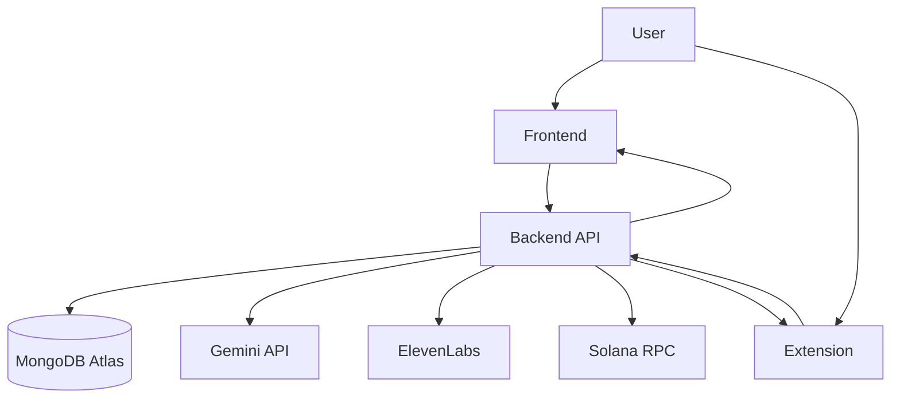

# Savant AI

**Explore research papers through citation-grounded conversations and interactive concept graphs.**

Built for HackCU and recognized as the **MLH MongoDB Track Winner**, as described in [Sansh's project background](https://sansh-portfolio.vercel.app/#projects).

[Architecture](docs/ARCHITECTURE.md) · [Workflow](docs/WORKFLOW.md) · [Roadmap](docs/ROADMAP.md) · [Contributing](CONTRIBUTING.md)

[Illustrated product walkthrough and Sansh's contributions](https://github.com/Sansh28/Sansh28/blob/main/case-studies/savant-walkthrough.md) — real local UI captures, contribution links, architecture trade-offs, and current demo limitations.

## Product experience

- Upload PDFs and ingest their content for retrieval.
- Ask questions with citations to supporting material.
- Revisit persisted conversations and document graph workspaces.
- Explore concept relationships and generated use cases.
- Extract paper context through a Chrome side panel.
- Experiment with optional voice playback and Solana payment checks.

This is a hackathon-origin application with continued engineering work. Provider-dependent functionality needs configured services. Generated answers require human verification; this README does not establish production readiness or a working public demo.

## Engineering focus

The application separates retrieval, model generation, persistence, and presentation across three applications. Graph workspaces persist by document ID. The backend, frontend, and extension each have dedicated test directories and validation commands below.

**Canonical repository:** [Sansh28/savant-ai](https://github.com/Sansh28/savant-ai). The [original prototype](https://github.com/Sansh28/savant-hackathon-prototype) preserves the earlier hackathon layout.

## Overview

Savant is a HackCU research assistant monorepo with three connected applications:

- a FastAPI backend for ingestion, retrieval, graph generation, persistence, and optional payment checks
- a Next.js frontend for upload, chat, citations, voice, and graph exploration
- a Chrome extension for paper-context extraction and side-panel concept trees

## Monorepo Layout

```text
savant-ai/
├── apps/
│   ├── backend/
│   ├── frontend/
│   └── extension/
├── docs/
├── .github/
├── README.md
└── AGENTS.md
```

## Project Workflow



Short workflow docs:

- [docs/WORKFLOW.md](./docs/WORKFLOW.md)
- [docs/DETAILED_WORKFLOW.md](./docs/DETAILED_WORKFLOW.md)
- [docs/ARCHITECTURE.md](./docs/ARCHITECTURE.md)
- [docs/ROADMAP.md](./docs/ROADMAP.md)

## Canonical Paths

- Backend source of truth: `apps/backend`
- Frontend source of truth: `apps/frontend`
- Extension source of truth: `apps/extension`
- Canonical Vercel deployment root: `apps/frontend`
- Product roadmap and delivery status: `docs/ROADMAP.md`

## App Breakdown

- `apps/backend`: FastAPI backend
- `apps/frontend`: Next.js web app
- `apps/extension`: Vite/React Chrome extension

## Frontend Deployment

The canonical Vercel project root is `apps/frontend`.

Use this exact setup in Vercel:

- Framework Preset: `Next.js`
- Root Directory: `apps/frontend`
- Install Command: `npm ci`
- Build Command: `npm run build`

This repository no longer uses root-level Vercel compatibility wrappers or the
legacy `savant-frontend` deployment path. If preview deployments fail, first
verify the Vercel project is pointed at `apps/frontend`.

## Tech Stack

- Backend: Python, FastAPI, Motor, PyPDF2, httpx, Gemini, ElevenLabs
- Frontend: Next.js 16, React 19, TypeScript, Tailwind CSS
- Extension: Vite, React 18, TypeScript, Chrome Extensions Manifest V3
- Data: MongoDB Atlas vector search

## Environment Setup

Use the root [.env.example](./.env.example) as a consolidated reference, then configure the app-specific env files:

- `apps/backend/.env.example`
- `apps/frontend/.env.example`
- `apps/extension/.env.example`

## Local Development

For the verified connected PDF → answer → citation → graph flow, follow
**[the local demo guide](docs/LOCAL_DEMO.md)**. It includes a dedicated MongoDB,
same-origin web/API proxy, real Gemini generation, and explicit local retrieval mode.

### Backend

```bash
cd apps/backend
python -m venv venv
source venv/bin/activate
pip install -r requirements.txt
uvicorn savant_backend.main:app --app-dir src --host 127.0.0.1 --port 8000 --reload
```

### Frontend

```bash
cd apps/frontend
npm install
npm run dev -- --hostname 127.0.0.1 --port 3000
```

### Extension

```bash
cd apps/extension
npm install
npm run build
```

Then open `chrome://extensions`, enable Developer Mode, choose `Load unpacked`, and select the built extension folder.

## Verification

- Backend tests: `cd apps/backend && python -m unittest discover -s tests -p "test*.py"`
- Frontend lint/typecheck: `cd apps/frontend && npm run lint && npm exec tsc -- --noEmit`
- Extension checks: `cd apps/extension && npm run typecheck && npm run build`
- Backend smoke flow: `cd apps/backend && pytest tests/test_api_flows.py -k smoke`

## What Lands In CI

- backend lint + test + smoke flow
- frontend test + lint + typecheck + build
- extension test + typecheck + build
- deployment assumption checks for the canonical frontend path

These are workflow definitions, not a claim of passing current runs. Inspect GitHub Actions for execution results. On Windows, activate the backend virtual environment with `venv\Scripts\activate`.

## Before hosting for others

Review document privacy, authentication, resource limits, provider availability and costs. Optional voice and payment integrations require their own credentials. Historical roadmap observations can predate later commits; inspect source and tests for current behavior.

## Contributor Docs

- [AGENTS.md](./AGENTS.md)
- [CONTRIBUTING.md](./CONTRIBUTING.md)
- [docs/README.md](./docs/README.md)
